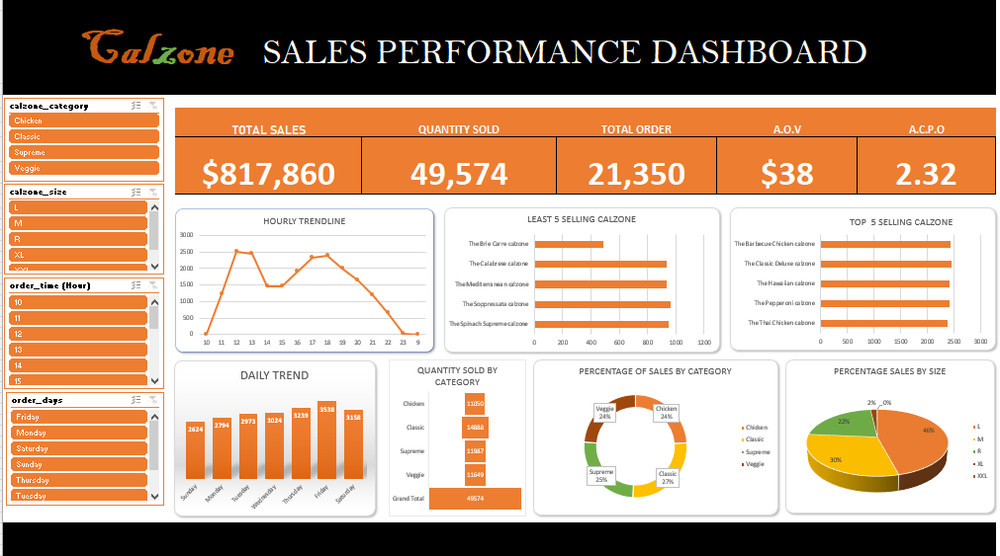
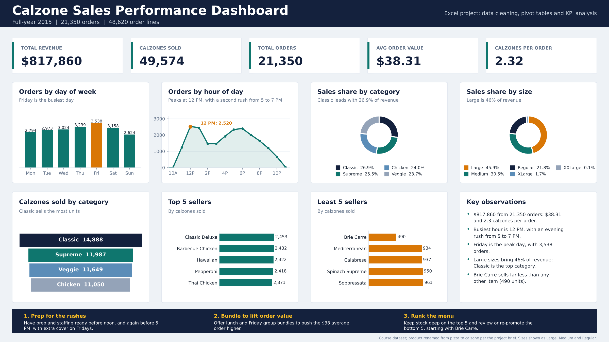

# Calzone Sales Analysis (Excel)

An Excel project that cleans a year of restaurant order data (48,620 order lines), analyses it with **pivot tables**, and presents the results in an interactive **slicer-driven dashboard** with written findings and recommendations.

> **Business question:** When are customers ordering, what are they buying, and how should the kitchen prepare?
> **Answer:** $817,860 in revenue from 21,350 orders. Demand peaks at 12 PM and again from 5 to 7 PM, Friday is the busiest day, Large sizes bring in 46% of revenue, and the Classic category leads on volume.

## Key findings

| Metric | Result |
|---|---|
| Total revenue | **$817,860** |
| Calzones sold | **49,574** |
| Total orders | **21,350** |
| Average order value | **$38.31** |
| Calzones per order | **2.32** |
| Peak hour | **12 PM** (2,520 orders), with a second rush from 5 to 7 PM (2,399 at 6 PM) |
| Busiest day | **Friday** (3,538 orders) |
| Size mix | **Large: 46%** of revenue, Medium 31%, Regular 22% |
| Top category | **Classic**: 14,888 units and 27% of revenue |
| Top seller | **Classic Deluxe** (2,453 units) |
| Weakest seller | **Brie Carre** (490 units), far behind the next lowest at 934 |

## Recommendations

1. **Prepare for both rushes.** Have prep and staffing ready before noon and again before 5 PM, with extra cover on Fridays.
2. **Bundle to lift order value.** Launch a lunch combo and a Friday bundle to push the $38 average order higher.
3. **Rank the menu.** Keep stock deep on the top 5 and review or re-promote the bottom 5, starting with Brie Carre.

## Redesigned dashboard view

A cleaner one-page version of the same analysis, built for sharing. A PDF copy is in [`docs/`](docs/Calzone_Dashboard_Reworked.pdf).

## What I did in Excel

**Data cleaning**
- Renamed the product from pizza to calzone across the dataset
- Standardised the size labels (L, M, R, XL, XXL)
- Added `distinct_order_id` using `=1/COUNTIF(B:B,[@[order_id]])`, so orders with several lines are counted once (it sums to exactly 21,350)
- Added `order_days` using `=TEXT(date,"dddd")` to get the day name

**Analysis with pivot tables**
- KPIs: total revenue, calzones sold and total orders (a distinct count using the helper column)
- Calculated measures: average order value (revenue divided by orders) and calzones per order
- Charts: daily trend (column), hourly trend (line), sales by category (donut), sales by size (3D pie), calzones sold by category (funnel), and top 5 and least 5 sellers (bar)

**Dashboard**
- KPI cards, eight charts, and four slicers (category, size, order time and order day) so the viewer can filter the whole page
- A separate sheet with executive findings and strategic recommendations

## Files

| File | Description |
|---|---|
| `Calzone_Sales_Analysis.xlsx` | The full workbook: brief, raw data, cleaned data, pivot tables, dashboard and findings |
| `docs/Calzone_Dashboard_Reworked.pdf` | PDF of the redesigned dashboard |
| `images/` | Dashboard screenshots |

## Skills demonstrated

Excel pivot tables, slicers, data cleaning, helper columns and formulas (`COUNTIF`, `TEXT`), KPI design, dashboard design, and turning data into recommendations.

## About the data

A course dataset covering January to December 2015, with the product renamed from pizza to calzone as part of the project brief.

## Contact

**Douglas Ogieva** | Benin City, Nigeria | [LinkedIn](https://www.linkedin.com/in/douglasogieva) | [Email](mailto:douglasogieva14@gmail.com)
